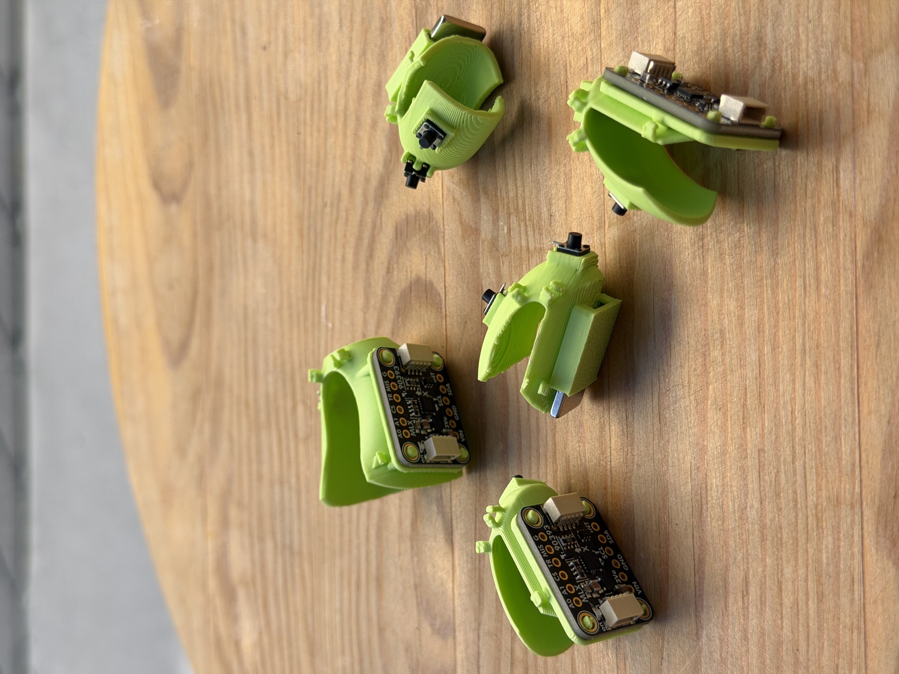
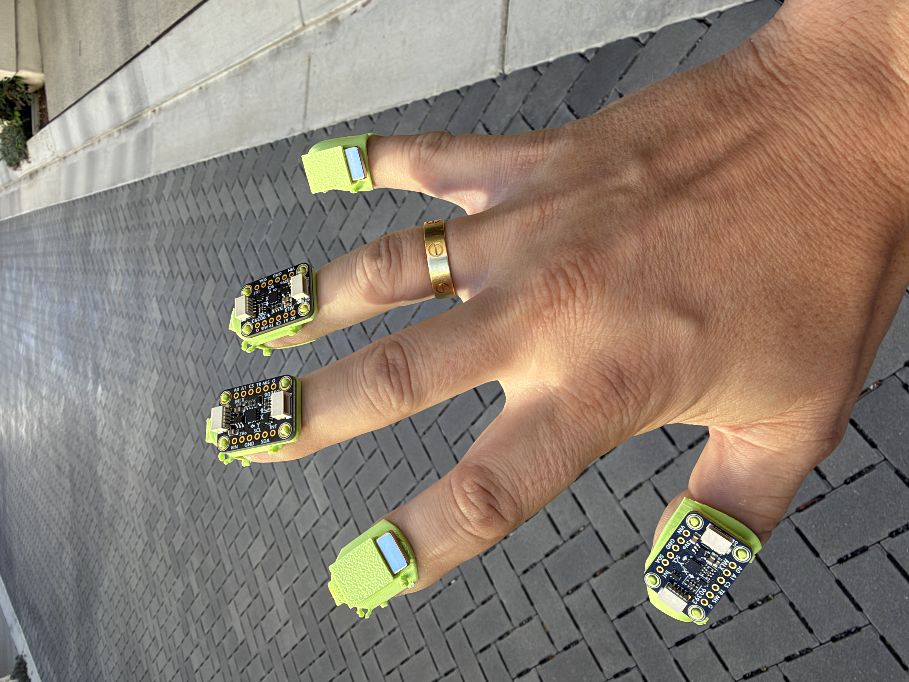
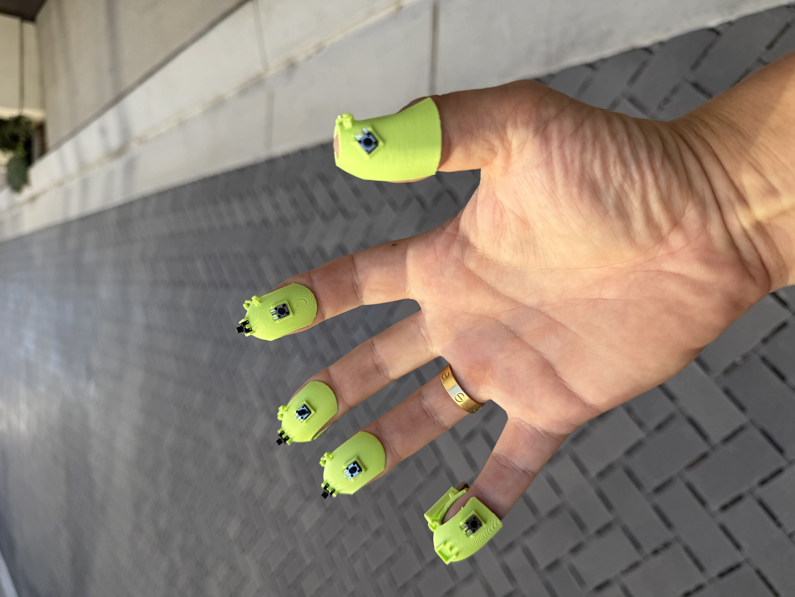
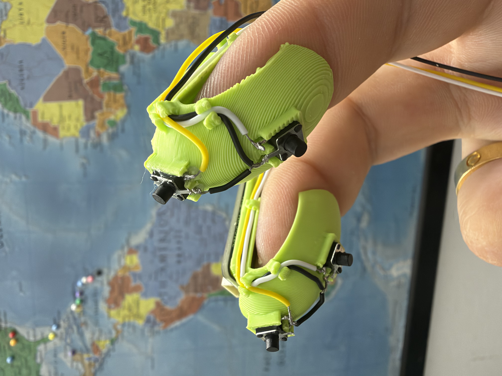
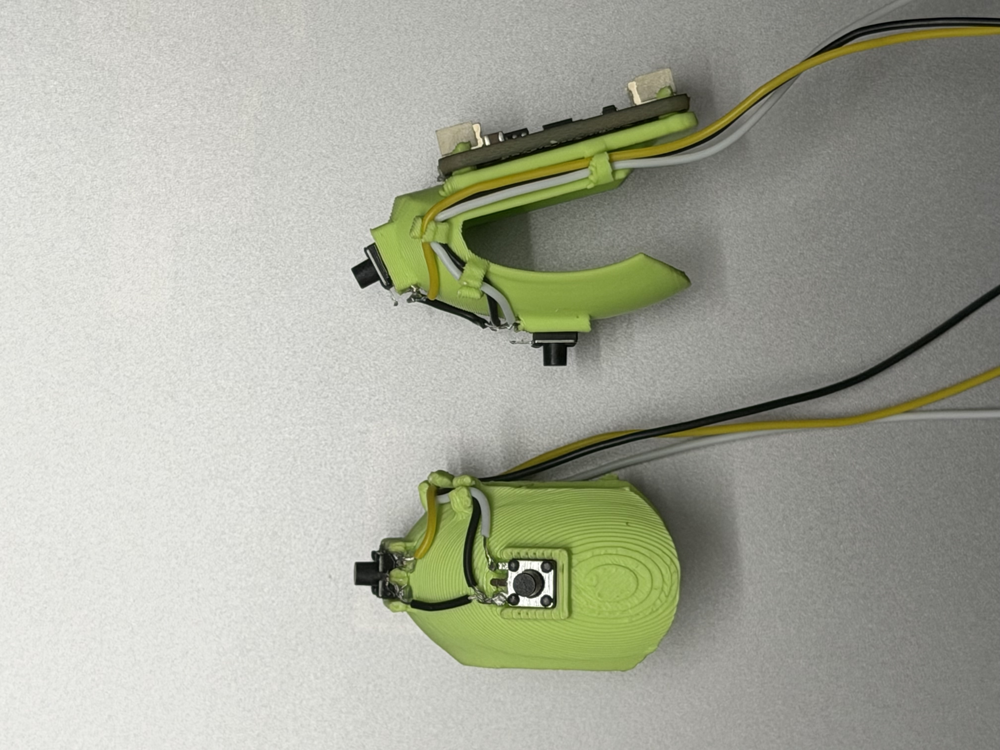

# Day 2 — 2026-10-27

## Goal

Start assembling: 3D-print the finger clips, fit them with the hardware, and start soldering.

## Done

- 3D-printed the finger clips for all fingers of the right hand.
- Assembled them with magnets, magnetometers, and buttons/switches.

- Started soldering: attached wires to the tactile buttons for the index and middle fingers.

## Failed / blocked

- Not a blocker, but I realized I'm missing some useful tools e.g. helping hands, flush cutters, and others, which would speed up the work.

## Learned

- Learned how to solder. I had very little soldering experience before; soldering is fun!
- The pinky 3D model is not comfortable at all - it is hard to click buttons; need to improve it.

## Decision

- Test the buttons e2e before continuing any more soldering.

## Tomorrow

- Wire the buttons for one or two fingers to the microcontroller board and test the wiring end to end to confirm the buttons work properly before continuing any soldering.
- Then assemble the whole system.
