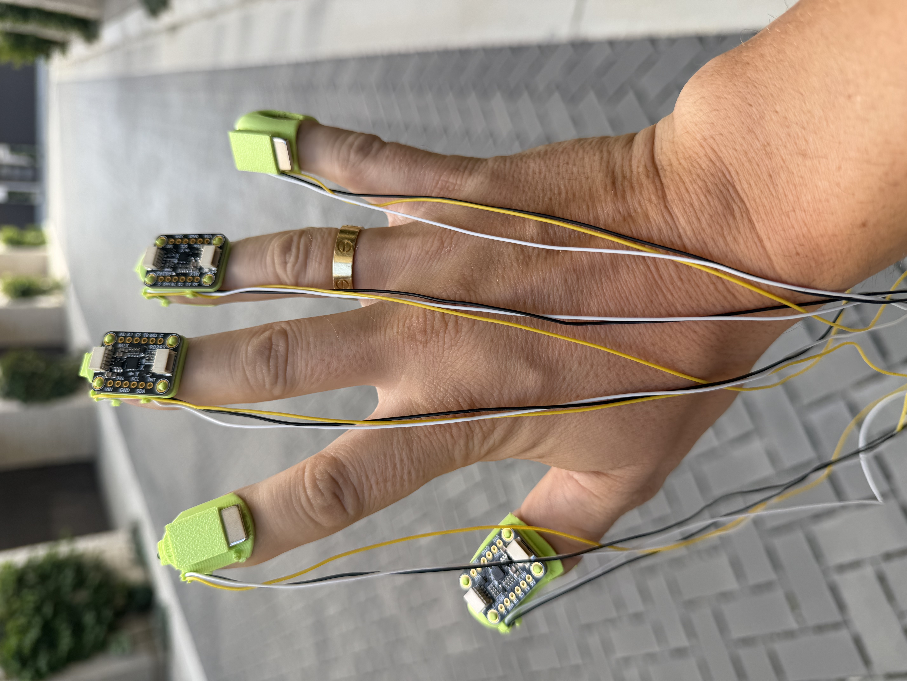
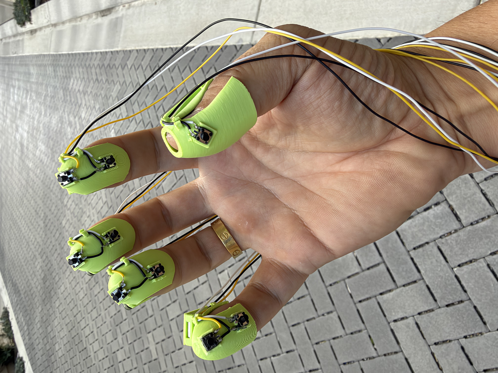
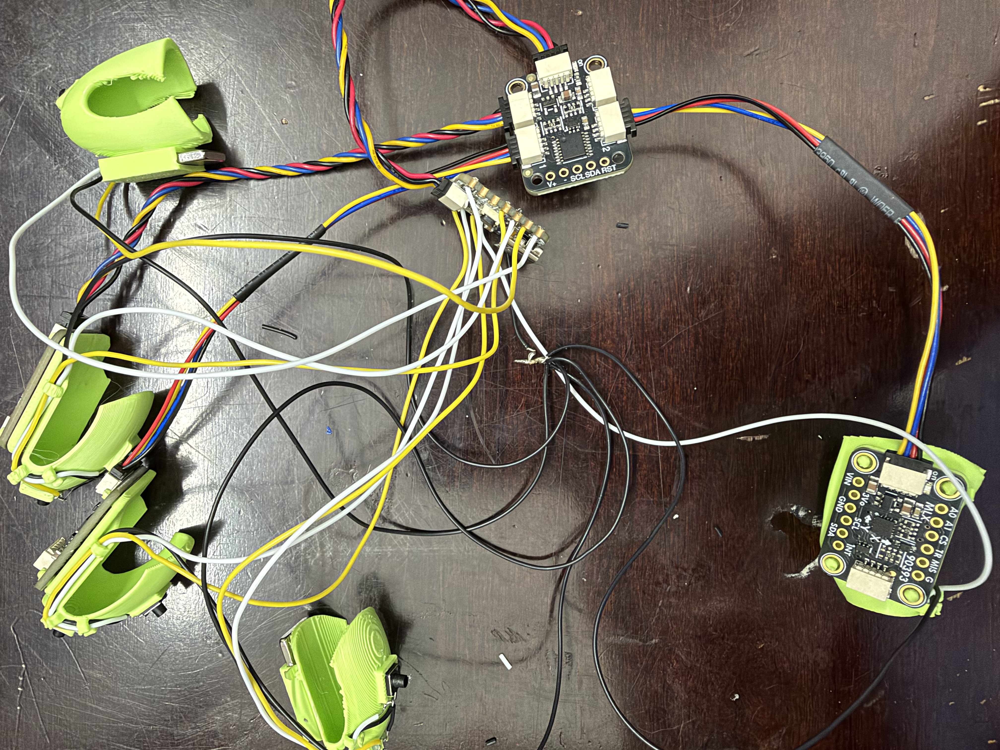

# Day 3 — 2026-10-28

## Goal

Wire up all nine buttons, test the buttons connectivity with a small script.

## Done

- Wired all nine buttons to the QT Py GPIOs.
- Wrote a small CircuitPython script to report each button's state (`pressed` / `released`) — see [button_test.py](../firmware/button_test.py).
- Tested the buttons end to end. All nine worked.

## Failed / blocked

- Nothing.

## Learned

- How to update the QT Py firmware and run CircuitPython on it.
- The quality of my soldering is very low. How do people on YouTube do it so easily? Soldering is not fun at all!

## Decision

- Move on to the magnetometers next: they are now the main open technical risk.

## Tomorrow

- Make some usability improvements to the assembly and make it a little less messy.
- Main goal: read the magnetometers and check whether the magnets produce a magnetic field strong enough for the magnetometers to sense at the distances between fingers.
- Design and 3D-print a plastic enclosure to organize the circuit boards and prevent direct contact with the skin.
