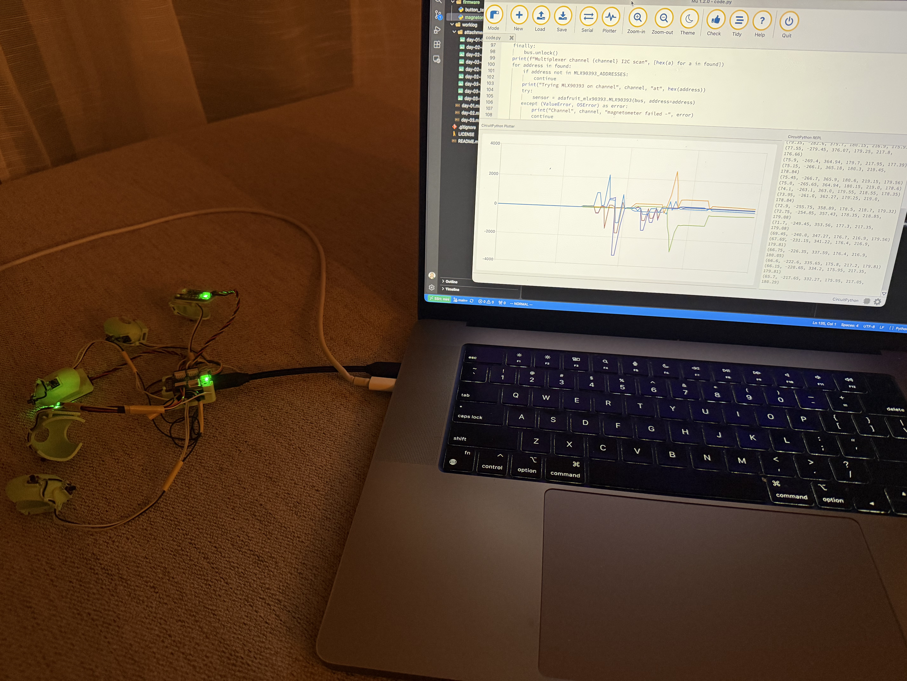
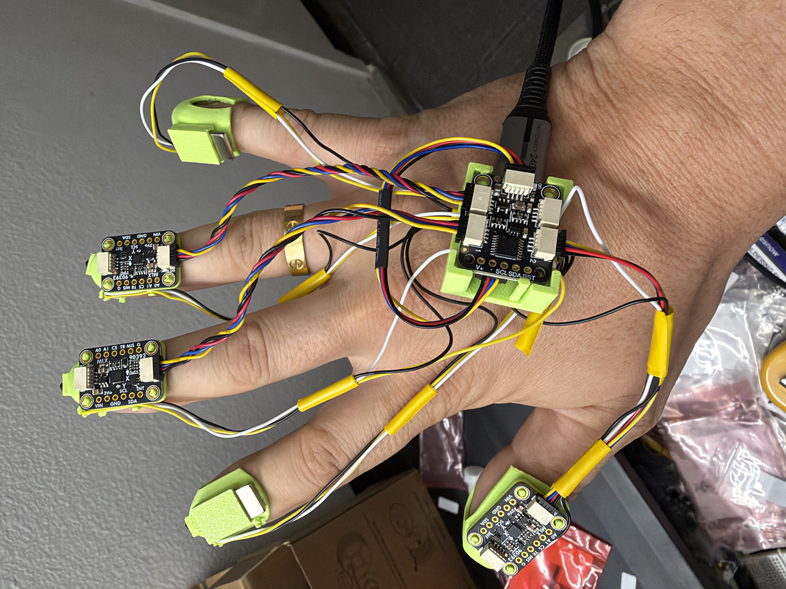

# Day 4 — 2026-10-29

## Goal

Verify the magnetometer readings, tidy up the assembly wiring, and create an enclosure for the boards.

## Done

- Read the magnetometers and plotted the readings live — see [magnetometer_test.py](../firmware/magnetometer_test.py). The sensitivity seemed appropriate for the distances between fingers.
- Made the assembly wiring less messy.
- Created a plastic box for the boards.

## Failed / blocked

- Nothing.

## Learned

- The magnetometers can read and plot the magnets' fields, and the sensitivity looks appropriate. The main technical risk from Day 3 is cleared for now.

## Decision

- Keep one magnet each on the index finger and pinky for now. If model training reveals the magnetic fields are too weak, I will add one more magnet to the index finger and the pinky.

## Tomorrow

- Start collecting data and training a classifier.
