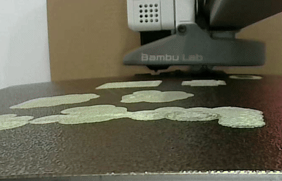

# Day 5 — 2026-10-30

## Goal

Re-print the clips and enclosure with better accuracy, reassemble the device, and build the full data pipeline: collection, training, and live inference.

## Done

- 3D-printed updated versions of the finger clips and the boards enclosure with a 0.2 mm nozzle for better accuracy.

- Re-assembled the device with the new clips and enclosure.
- Wrote the streaming firmware — see [stream.py](../firmware/stream.py). It streams synchronised magnetometer + button readings from the QT Py to the computer as CSV.
- Wrote the host tools in [host/](../host/README.md): [collect.py](../host/collect.py) for prompted data collection, [train.py](../host/train.py) for training the classifier, and [live.py](../host/live.py) for real-time inference.
- Collected an initial dataset and trained a first classifier. The confusion matrix looks promising so far.

## Failed / blocked

- The magnetometers initially failed to initialise reliably through the I2C multiplexer (`ETIMEDOUT`, sensors NAK-ing during init). Fixed with repeated-start transactions, init retries, and per-channel recovery — see [sensor_discovery.py](../firmware/sensor_discovery.py).
- Button presses were being missed in the stream: with the magnetometer library defaults, one sensor read blocks ~220 ms, so a whole sampling cycle took ~0.7 s and quick taps fell between samples. Fixed by running the magnetometers with a fast conversion setting (~3 ms per read), polling the buttons between sensor reads, and latching every observed press until it has been emitted — see [button_latch.py](../firmware/button_latch.py).

## Learned

- The MLX90393 conversion-time setting matters enormously: the library defaults (heavy filtering/oversampling) are fine for a 1 Hz plotter demo but unusable for keystroke timing.
- The initial data separates well enough to train a classifier with a promising confusion matrix — the magnetic signatures per key look distinct, at least within a single session.

## Decision

- The within-session results are encouraging, but the number that matters is accuracy after taking the device off and putting it back on. Tomorrow's multi-session data will decide whether the approach generalises.

## Tomorrow

- Collect multiple sessions of training data, taking the device off and on between sessions.
- Train the model across sessions and check the cross-session accuracy (leave-one-session-out).
- Goal: an accurate model ready to use for live inference.
